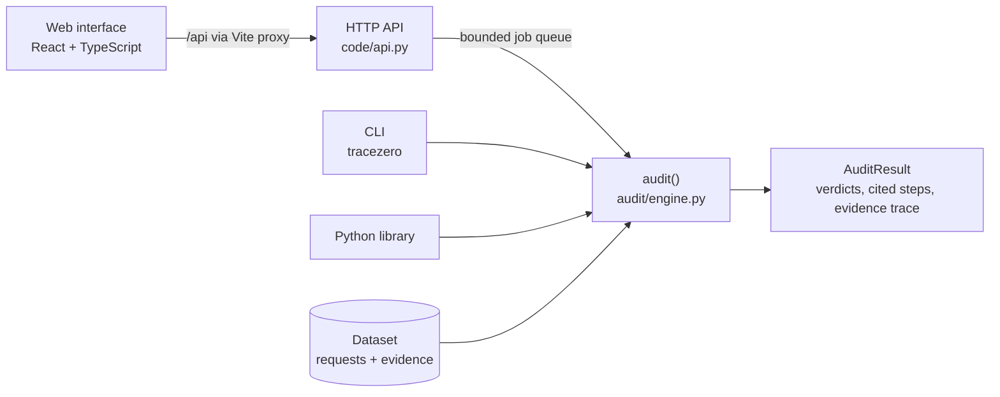
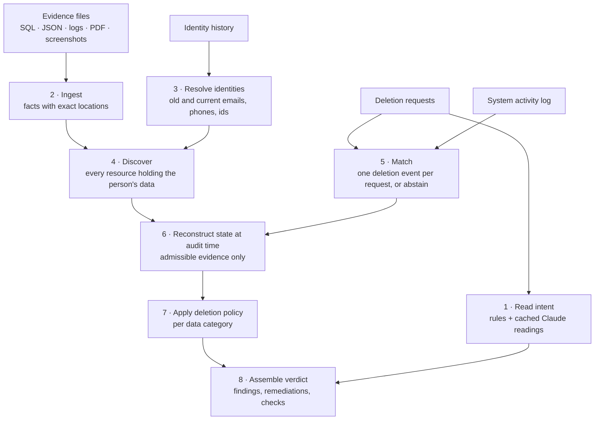
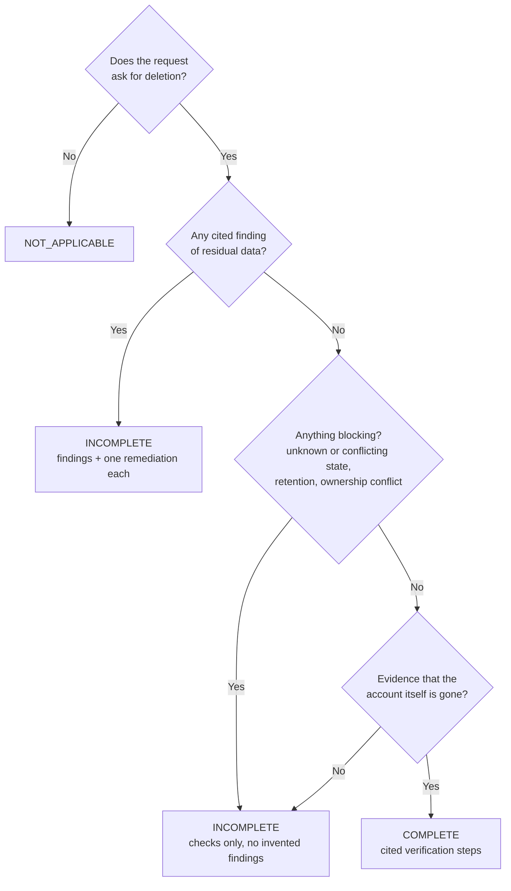

# TraceZero

[](https://github.com/ayushgade06/tracezero/actions/workflows/ci.yml)
[](LICENSE)

**Proves whether a data deletion actually happened, using the evidence instead of the status flag.**

When a company says *"your data has been deleted"*, that usually means a ticket was closed. The data can still
sit in a search index, a backup, a downstream sync or a support export. TraceZero reads the evidence an
organisation already has (database snapshots, logs, JSON exports, PDFs and admin-console screenshots) and
decides, for every deletion request, whether deletion was really complete at the time it was audited.

> **Absence of evidence is not evidence of absence.** TraceZero never marks a request complete just because it
> found nothing.

## What you get

For each deletion request, one verdict:

| Status | Meaning |
|---|---|
| `COMPLETE` | The evidence shows the data is gone |
| `INCOMPLETE` | Residual data was found, or the evidence can't prove deletion |
| `NOT_APPLICABLE` | The request wasn't asking for deletion |

Each verdict comes with ordered steps:
- **findings**, each citing the exact file and location (table row, log line, JSON path, PDF page);
- **remediations**, exactly one per finding;
- **verification checks** that must pass afterwards.

It runs as a **CLI**, a **Python library**, a local **HTTP API**, and a **web interface** where you read each
request's evidence trail like a case file.

## Quick start

Needs Python 3.10+ (and Node.js 22.22+ for the web interface). The repository includes a small, fictional
[demo dataset](code/tests/fixtures/demo/README.md).

```bash
git clone https://github.com/ayushgade06/tracezero.git && cd tracezero
python -m venv .venv && . .venv/bin/activate        # Windows: .venv\Scripts\activate
pip install -e .
tracezero --dataset code/tests/fixtures/demo --out demo_output.csv
```

The demo has 4 requests: residual data (`case_901`), a proven deletion (`case_902`), evidence that can't decide
(`case_903`) and a request that isn't about deletion (`case_904`).

**Web interface.** Run each line in its own terminal, then open http://127.0.0.1:5173:

```bash
python code/api.py
cd web && npm ci && npm run dev
```

Press **Run audit** with `demo` selected. Open `case_901` and click a resource in its steps to jump to the
evidence behind that finding. Stop either server with Ctrl+C.

## How it works

### System overview

Every interface goes through one function, `audit()`, so there is only ever one way an audit happens. The API
and the web interface add no audit logic: the web interface only displays what the engine returned.



### The audit pipeline

One deterministic pass over all requests. Each stage keeps a record of where every fact came from, which is what
makes the final citations possible.



| Stage | Key idea |
|---|---|
| Ingest | SQL is parsed, never executed. Five log formats, PDF pages, and OCR for screenshots (cached, so normal runs need no OCR engine) |
| Resolve identities | People change emails and phone numbers. Every identifier has a validity window, and only exact matches count |
| Match | Requests and events are matched **globally** as an assignment problem (SciPy `linear_sum_assignment`), so one event can't satisfy two requests. A near-tie means **abstain**, never guess |
| Reconstruct state | Only evidence captured by the audit date counts. `UNKNOWN` and `CONFLICTING` are explicit outcomes |
| Apply policy | A configurable rules matrix ([`deletion_rules.csv`](code/audit/deletion_rules.csv)) labels each resource `VIOLATION`, `COMPLIANT`, `INCONCLUSIVE` or `NOT_ATTRIBUTABLE`. Unclear ownership withholds a finding instead of blaming the wrong person |

### How a verdict is decided



## Results

- **Accuracy** on the 32 reference cases: status 0.875, step-level F1 0.907 (precision 0.960, recall 0.860).
- **Coverage:** across 518 requests and 94 evidence files, all 2,531 resource ids in the raw evidence are
  accounted for.
- **Reproducible:** identical inputs give byte-identical output on Windows and Linux, checked against a
  recorded SHA-256 of the reference run.
- **Tested:** 308 Python tests and 32 web tests, run by CI on every push. The reference-dataset tests skip
  without the private data.

## Project structure

```text
code/
  audit/          the engine: ingest, identity, discovery, matching, state, policy, final verdict
  api.py          local HTTP API (standard library only)
  main.py         CLI
  evaluation/     strict output validator and evaluation reports
  tests/          unit and end-to-end tests, plus the fictional demo dataset
web/              React + TypeScript web interface (Vite)
docs/             architecture, API, configuration, development and verification records
```

## Scope and limitations

TraceZero is built for **local use** by one operator. It is not ready for public or shared deployment:

- **No authentication.** Keep the API on `127.0.0.1`. It only answers `localhost` and IP-address hosts, which
  blocks DNS-rebinding attacks.
- **Results are sensitive.** They quote evidence that may contain personal data.
- **No persistent history.** The API keeps the 32 most recent finished audits in memory, and a restart clears
  them.
- **Evidence is shown by reference.** The web interface shows each citation's file and location, not the
  evidence file itself.
- **Datasets are trusted input.** The API refuses a dataset whose manifest points outside its own folder.

## Documentation

| Document | Contents |
|---|---|
| [`docs/DEVELOPMENT.md`](docs/DEVELOPMENT.md) | Install details, CLI options, dataset format, caches, tests |
| [`docs/ARCHITECTURE.md`](docs/ARCHITECTURE.md) | Modules and the full execution flow |
| [`docs/API.md`](docs/API.md) | HTTP endpoints, job states, errors, configuration |
| [`docs/CONFIGURATION.md`](docs/CONFIGURATION.md) | Custom policy, settings, request files, input validation |
| [`code/DESIGN.md`](code/DESIGN.md) | Per-stage rules, design decisions, web interface design |
| [`docs/BASELINE.md`](docs/BASELINE.md) | Verification runs and their recorded results |
| [`docs/ROADMAP.md`](docs/ROADMAP.md) | Phases done and what's next |

## License

[Apache License 2.0](LICENSE); see also [`NOTICE`](NOTICE).
